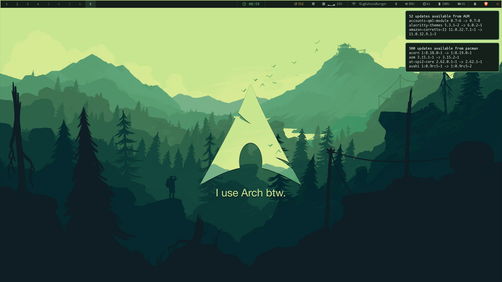
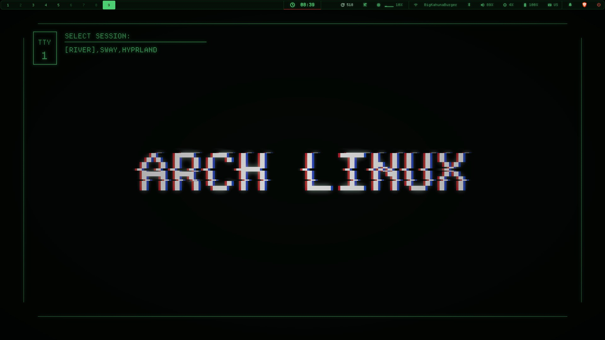
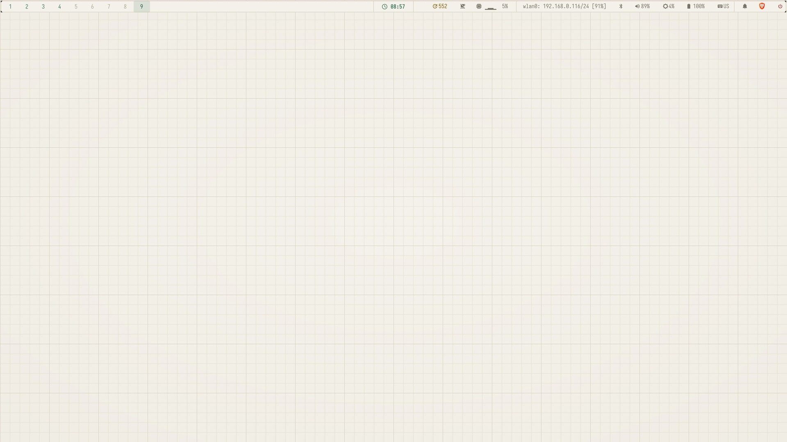
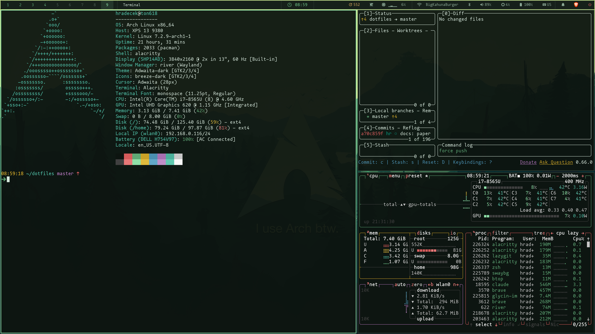
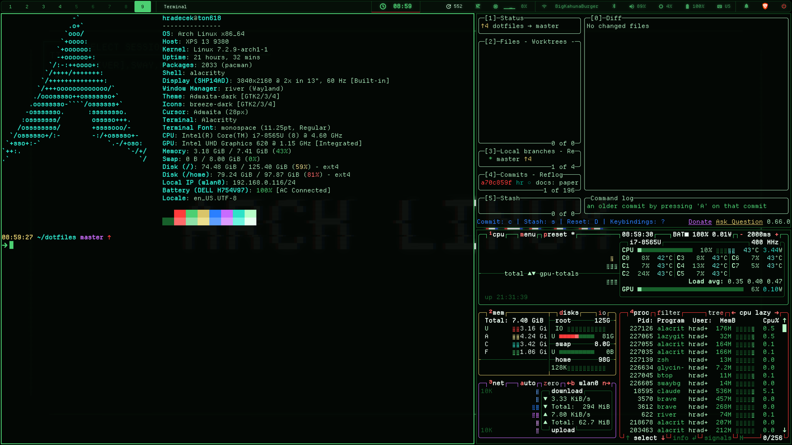
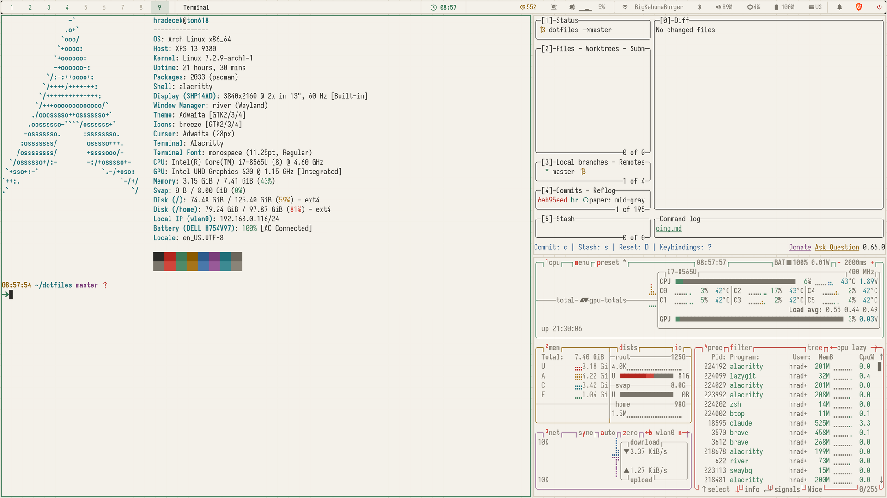

<div align="center">

# ⚙️ dotfiles

#### Cross-platform [chezmoi](https://www.chezmoi.io/) dotfiles for a tiling **River / Wayland** desktop on **Arch Linux** — with a matching setup on **Windows**.


<br>

<table>
<tr><th>colors2</th><th>retro</th><th>paper</th></tr>
<tr>
<td></td>
<td></td>
<td></td>
</tr>
<tr>
<td></td>
<td></td>
<td></td>
</tr>
</table>

<sub>🎨 Switchable themes - one command restyles Alacritty, Waybar, Fuzzel, mako, River, swaylock, GTK and the wallpaper.</sub>

</div>

---

## 🧩 The stack

|  |  |  |
|---|---|---|
| 🪟 **WM** · [River](./home/dot_config/river/) | 📊 **Bar** · [Waybar](./home/dot_config/waybar/) | 🚀 **Launcher** · [Fuzzel](./home/dot_config/fuzzel/) |
| 🔔 **Notifications** · [mako](./home/dot_config/mako/) | 🐚 **Shell** · [ZSH](./shell/zsh/README.md) / PowerShell | ✨ **Prompt** · [Starship](./home/dot_config/starship.toml) |
| 🖥️ **Terminal** · [Alacritty](./home/dot_config/alacritty/) | 📝 **Editor** · [NeoVim / LazyVim](./home/dot_config/nvim/README.md) | 🌿 **VCS** · [Git](./home/dot_gitconfig.tmpl) |
| 🎨 **Themes** · [`theme`](./home/dot_config/themes/README.md) | 🔒 **Lock** · [swaylock](./home/dot_config/swaylock/) | ⌨️ **Keys** · [keyd](./keyd/) |

---

## 🚀 Install

```shell
git clone <repo-url> ~/dotfiles
chezmoi init --source ~/dotfiles   # writes ~/.config/chezmoi/chezmoi.toml pointing at the clone
chezmoi diff                       # 👀 preview
chezmoi apply                      # ✍️  write configs into place
```

> [!IMPORTANT]
> chezmoi writes real files and won't clobber existing **symlinks** — if migrating from the
> old Make setup, remove the old `~/.config/*` and `~/.*` symlinks before the first `apply`.

### 📦 Packages

On Linux, `apply` first bootstraps `yay` (once), then installs any missing system packages
declared in [`home/.chezmoidata/packages.yaml`](./home/.chezmoidata/packages.yaml) — a
`run_onchange` script that re-runs **only** when that list changes and is a no-op once everything
is present.

> [!NOTE]
> The only prerequisite it can't bootstrap itself is `chezmoi`.

### 🐧 Linux — one-time system setup

Root-level pieces chezmoi doesn't manage (LY display manager, keyd):

```shell
sh ~/dotfiles/bootstrap/linux-system.sh
```

### 🪟 Windows

Prerequisites `winget` can't be relied on to place correctly — install these first:

- **PowerShell 7 — the MSI build, not the Store/MSIX one.** `winget install Microsoft.PowerShell`
  keeps managing the Store build (a WindowsApps alias Alacritty can't launch); grab the MSI from
  [PowerShell releases](https://github.com/PowerShell/PowerShell/releases) → stable
  `C:\Program Files\PowerShell\7\pwsh.exe`.
- **Starship** · `winget install Starship.Starship`

```powershell
git clone <repo-url> C:\projects\dotfiles
chezmoi init --source C:\projects\dotfiles   # writes %USERPROFILE%\.config\chezmoi\chezmoi.toml
chezmoi diff                                 # 👀 preview
chezmoi apply                                # ✍️  write configs + run Windows scripts
```

`apply` deploys only the cross-platform configs (Alacritty, Neovim, Git, the PowerShell profile);
the Wayland stack is skipped via `.chezmoiignore`. The Windows `run_once`/`run_onchange` scripts
also set `XDG_CONFIG_HOME=%USERPROFILE%\.config` (Neovim reads it — **relog once**) and install the
Nerd Fonts from `packages.yaml` per-user (**registered**, not just copied, or Windows won't see them).

> [!NOTE]
> **Alacritty on Windows ignores `XDG_CONFIG_HOME`** — it only reads `%APPDATA%\alacritty`. A
> generated shim there imports the real `~/.config\alacritty` config (single source of truth, colors2 theme), and
> launches **PowerShell 7** in `C:\projects` with the same **Starship** prompt and git aliases as zsh.

---

## 🎨 Themes

Colors, fonts and the wallpaper live in [`home/dot_config/themes/`](./home/dot_config/themes/), one
directory per theme. Switch on Linux with:

```shell
theme           # list themes, * marks the active one
theme retro     # switch and live-reload
```

The choice survives `chezmoi apply`. Windows has no switcher; Alacritty there uses colors2. What a
theme contains and how to add one: [themes README](./home/dot_config/themes/README.md).

---

## 🗂️ Layout

| Path | What lives here |
|------|-----------------|
| 📁 `home/` | chezmoi source (`.chezmoiroot` points here) — see [`CLAUDE.md`](./CLAUDE.md) for naming conventions. Includes `.chezmoidata/packages.yaml` (the package manifest) and `run_onchange_install-packages.sh.tmpl`. |
| 🐚 `shell/` | runtime libs sourced by `~/.zshrc` (aliases, history, ssh askpass helper) |
| 🥾 `bootstrap/` | one-time Linux system installers |
| 🔧 `dm/`, `jobs/`, `swaylock/assets/` | Linux system configs / assets |
